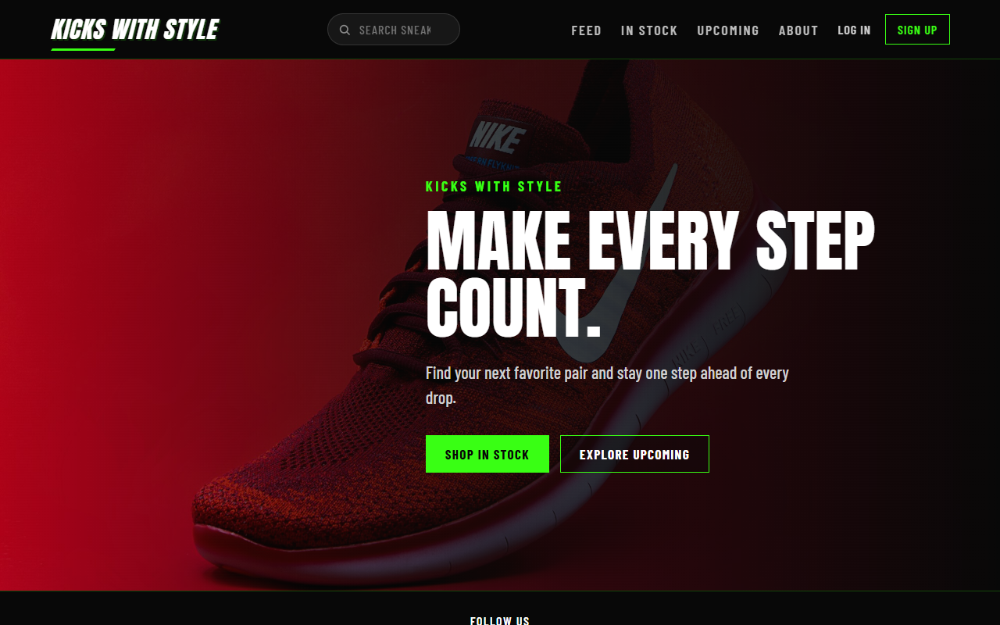
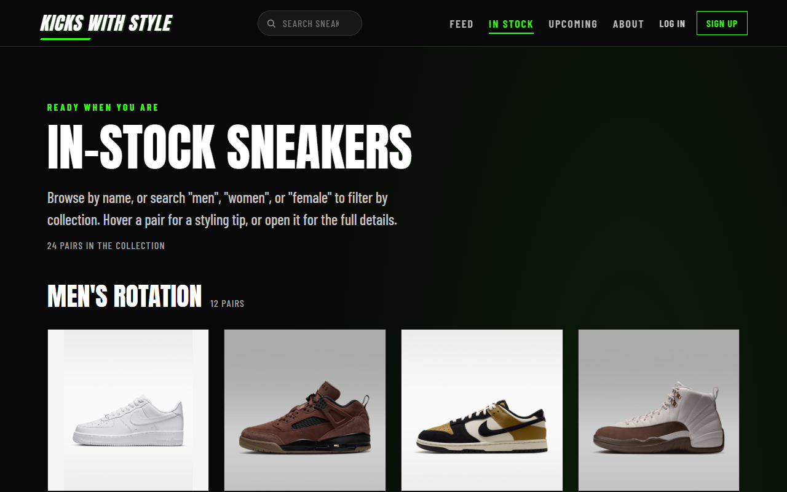
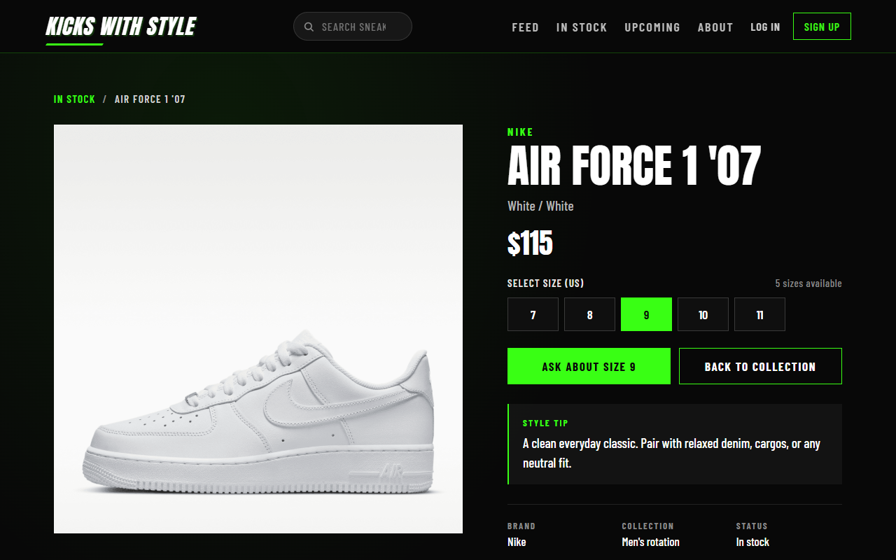
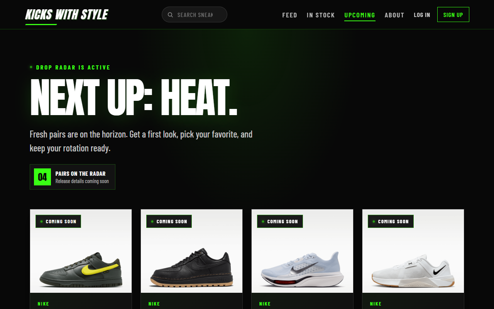
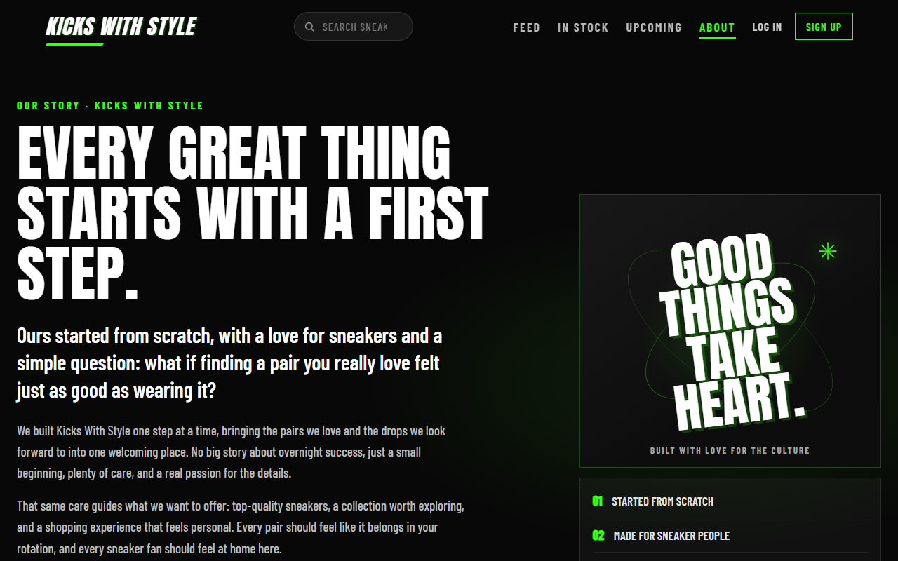
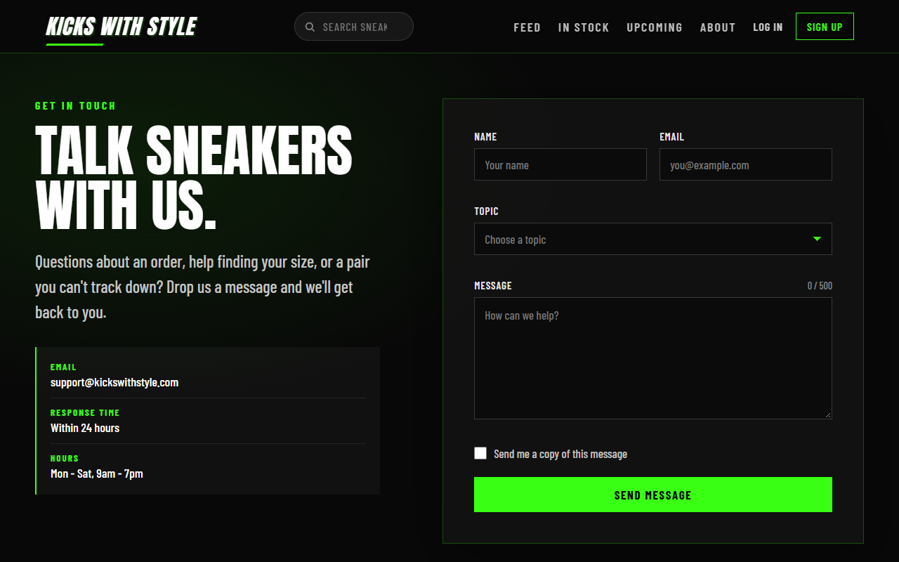
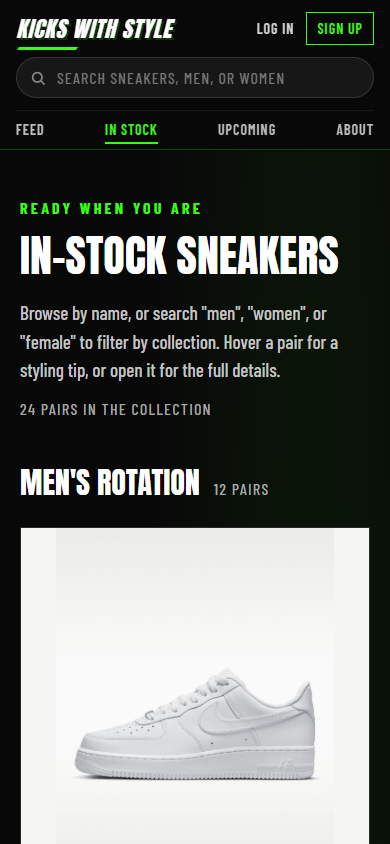

# Kicks With Style

This is a sneaker store website I made with React for my web development course. You can look through the sneakers that are in stock, see the ones coming soon, open any pair to see more details about it, and send a message from the contact page.

I chose sneakers because I'm really into them, so it was fun to work on.

Live site: (add link here)

## Pages

- Home: the landing page with buttons to go to the shop or the upcoming sneakers
- In Stock: all the sneakers, split into men's and women's. If you hover on a card you get a style tip
- Upcoming: sneakers that are not released yet
- Sneaker details: every sneaker has its own page (`/sneakers/:id`) with the price, sizes and similar sneakers at the bottom
- About: a bit about the store
- Contact: a form that checks the name, email and message before you can send it
- Login and Sign up: the forms are done but there's no backend yet so they don't work for now

There's also a search bar in the navbar. You can search by name, brand or color, or type "men" or "women" to only see that collection.

The site is responsive so it works on phone, tablet and laptop.

## Screenshots

Home


In Stock


Sneaker details


Upcoming


About


Contact


Mobile


## Technologies

- React
- React Router
- Vite
- CSS

## How to run it

You need Node.js installed.

```bash
git clone https://github.com/<your-username>/<repo-name>.git
cd <repo-name>/Frontend
npm install
npm run dev
```

Then open http://localhost:5173 in your browser.

To make a production build:

```bash
npm run build
```

## Deployment

The site is hosted on Vercel. The `vercel.json` file in the Frontend folder makes sure pages like `/sneakers/air-force-1-07` still work when you refresh them.

## Folders

```
Frontend/
  src/
    assets/       images (hero + sneakers)
    Components/   Navbar and Footer
    data/         sneakers.js has all the sneaker info
    Pages/        all the pages
    services/     api.js for login and sign up
    Styles/       css files
    App.jsx       routes
    main.jsx
```

## Things I want to add later

- A backend so login, sign up and contact actually work
- A cart
- Filter by size and price

## Images

The sneaker pictures are from Nike's website and the home background is from Unsplash. I only used them for this school project.
